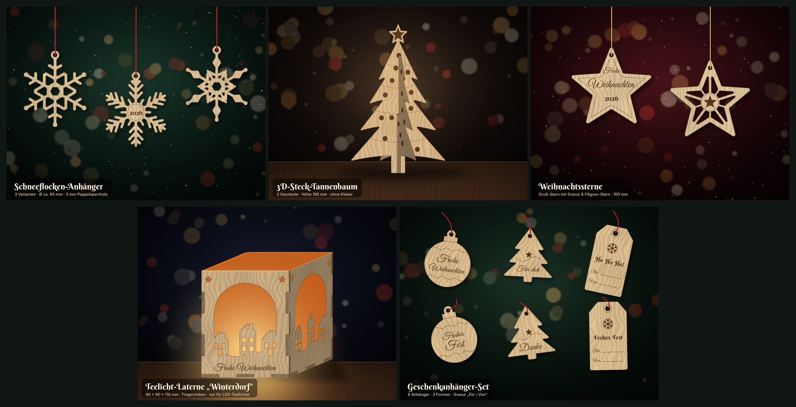
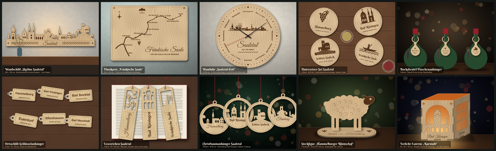
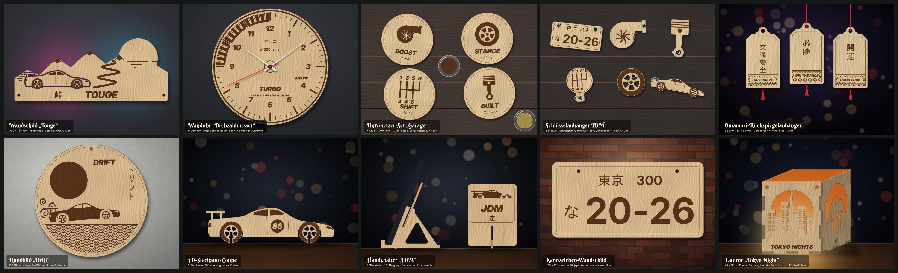
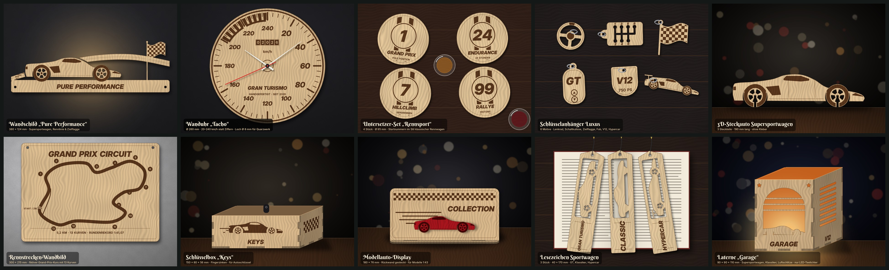

# Weihnachtsdeko für den xTool D1 Pro 10W

Fünf Entwürfe als laserfertige SVG-Dateien (Maßstab 1:1 in mm) mit Mockup und Laservorschau.



| # | Entwurf | Teile | Fläche (mm) | Datei |
|---|---------|-------|-------------|-------|
| 1 | Schneeflocken-Anhänger (3 Varianten, eine mit „2026“) | 3 | 216 × 90 | `entwuerfe/01_schneeflocken/01_schneeflocken.svg` |
| 2 | 3D-Steck-Tannenbaum, 180 mm hoch, plus Passungstest | 3 | 256 × 215 | `entwuerfe/02_steck-tannenbaum/02_steck-tannenbaum.svg` |
| 3 | Weihnachtssterne: Gruß-Stern + Filigran-Stern, 100 mm | 2 | 193 × 94 | `entwuerfe/03_sterne/03_sterne.svg` |
| 4 | Teelicht-Laterne „Winterdorf“, 90 × 90 × 110 mm, Fingerzinken | 5 | 292 × 236 | `entwuerfe/04_teelicht-laterne/04_teelicht-laterne.svg` |
| 5 | Geschenkanhänger-Set (Kugel, Baum, klassisch) | 6 | 248 × 163 | `entwuerfe/05_geschenkanhaenger/05_geschenkanhaenger.svg` |

Alle Entwürfe passen auf die Arbeitsfläche des D1 Pro (432 × 406 mm). Ausgelegt sind sie für **3 mm Pappel- oder Lindensperrholz**.

## Farben = Bearbeitungsart (in xTool Creative Space)

| Farbe | Ebene | Bearbeitung in XCS |
|-------|-------|--------------------|
| 🔴 Rot `#FF0000` | Schneiden | **Schneiden** (Kontur) |
| 🔵 Blau `#0000FF` | Gravieren | **Gravieren** (Flächenfüllung) |
| ⚫ Schwarz `#000000` | Linie | **Gravieren**, Modus *Linie/Ritzen* (Score) |

Die Dateien enthalten keine Schrift-Objekte: Alle Texte sind bereits in Pfade umgewandelt.

## Startwerte für den D1 Pro 10W

| Vorgang | Leistung | Geschwindigkeit | Durchgänge | Hinweis |
|---------|----------|-----------------|------------|---------|
| Schneiden 3 mm Linde | 100 % | 8–12 mm/s | 1 | Air Assist an |
| Schneiden 3 mm Pappelsperrholz | 100 % | 6–10 mm/s | 1–2 | Leimschicht kann einen 2. Durchgang brauchen |
| Gravieren (Fläche) | 25–40 % | 150–250 mm/s | 1 | ca. 100 Linien/cm |
| Linie (Score) | 20–30 % | 50–80 mm/s | 1 | |

Holz fällt sehr unterschiedlich aus. Mach deshalb vorher ein **Materialtest-Raster** in XCS und stell den Fokus genau ein.

**Reihenfolge:** zuerst gravieren, dann Linien, **zuletzt schneiden**. In der SVG ist das so vorsortiert, und innere Ausschnitte werden vor der Außenkontur geschnitten. Ein Abdeckband (Malerkrepp) auf dem Holz verhindert Rauchspuren.

## Tipps zu den einzelnen Entwürfen

1. **Schneeflocken:** Die Stege sind 3 mm breit. Für Bänder und Garn hat jede Flocke eine Öse mit Ø 4 mm.
2. **Steck-Tannenbaum:** Teil A wird von unten, Teil B von oben zusammengesteckt. Der Schlitz ist auf **2,9 mm** ausgelegt. Schneide zuerst den **Passungstest-Streifen** mit Schlitzen von 2,7 bis 3,2 mm und prüf, welcher Schlitz stramm sitzt. Weicht dein Wert ab, ändere `SLOT` in `tools/designs.py` und erzeuge die Dateien neu.
3. **Sterne:** Den Text („Frohe Weihnachten 2026“) kannst du in XCS löschen und durch einen Namen ersetzen.
4. **Laterne:** Die Teile sind Vorderwand (mit Gravur), Rückwand, zwei Seitenwände und der Boden mit Ø-22-mm-Loch für den Schalter des LED-Teelichts. Die Zinken stecken sich zusammen, ein Tropfen Holzleim macht die Laterne stabil. Wenn du Transparentpapier von innen einklebst, wird das Licht weicher. ⚠️ **Nur LED-Teelichter verwenden, keine echten Kerzen!**
5. **Geschenkanhänger:** Auf „Für:“ und „Von:“ kannst du mit Bleistift oder Fineliner schreiben. Für Kordel oder Garn gibt es Löcher mit Ø 4–5 mm.

## Dateien neu erzeugen und anpassen

```bash
pip install shapely fonttools cairosvg pillow numpy
python3 tools/build.py
```

- `tools/designs.py`: Formen, Texte, Materialstärke (`MAT`) und Schlitzbreite (`SLOT`)
- `tools/lasergeo.py`: Geometrie, Text-zu-Pfad und SVG-Export
- `tools/render.py` und `tools/build.py`: Mockups und Vorschauen

Die Schriften *Great Vibes* und *Berkshire Swash* stehen unter der SIL Open Font License (siehe `tools/fonts/`).

---

# Saaletal-Serie: Hammelburg, Bad Kissingen und die Fränkische Saale

Zehn weitere Entwürfe mit regionalem Bezug, ebenfalls für den **xTool D1 Pro 10W** und **3 mm Pappel- oder Lindensperrholz**. Farben, Laserwerte und Schneidreihenfolge wie oben.



| # | Entwurf | Teile | Maße (mm) | Datei |
|---|---------|-------|-----------|-------|
| 1 | Wandschild „Skyline Saaletal“: Hohntor, Kurstadt-Kirchen, Arkaden, Trimburg, Hammelburg, Schloss Saaleck mit Weinberg | 1 | 380 × 100 | `entwuerfe/saaletal/01_skyline-saaletal/` |
| 2 | Flusskarte „Fränkische Saale“: 11 Orte von der Quelle bis Gemünden, Rhön, Main, Kompass | 1 | 300 × 215 | `entwuerfe/saaletal/02_flusskarte-saale/` |
| 3 | Wanduhr „Saaletal-Zeit“: 12 Saale-Orte statt Ziffern, Mini-Skyline | 1 | Ø 260 | `entwuerfe/saaletal/03_wanduhr-saaletal/` |
| 4 | Untersetzer-Set: Hammelburg, Bad Kissingen, Schloss Saaleck, Fränkische Saale | 4 | je Ø 95 | `entwuerfe/saaletal/04_untersetzer-saaletal/` |
| 5 | Bocksbeutel-Flaschenanhänger: „Hammelburg“, „Zum Wohl!“, „Schloss Saaleck“ | 3 | 60 × 129 | `entwuerfe/saaletal/05_bocksbeutel-anhaenger/` |
| 6 | Schlüsselanhänger im Ortstafel-Stil (6 Orte) | 6 | 72 × 30 | `entwuerfe/saaletal/06_ortsschild-anhaenger/` |
| 7 | Lesezeichen: Weinrebe, Arkaden, Kanu auf der Saale | 3 | 40 × 150 | `entwuerfe/saaletal/07_lesezeichen/` |
| 8 | Christbaumanhänger mit Durchbruch: Hammelburg, Bad Kissingen, Saaleck, Trimburg | 4 | Ø 80 | `entwuerfe/saaletal/08_christbaumanhaenger/` |
| 9 | Steckfigur „Hammelburger Rhönschaf“ mit Bodenplatte | 2 | 114 × 80 / 132 × 58 | `entwuerfe/saaletal/09_steckfigur-rhoenschaf/` |
| 10 | Teelicht-Laterne „Kurstadt“: Arkaden, Zwiebelkuppel, Doppeltürme, Gradierbau-Seiten | 5 | 90 × 90 × 110 | `entwuerfe/saaletal/10_laterne-kurstadt/` |

Jeder Ordner enthält die laserfertige SVG, eine Laservorschau (PNG) und ein Mockup (JPG). Alle Arbeitsflächen passen auf den D1 Pro.

Die Gebäude sind **stilisierte Silhouetten**, keine maßstabsgetreuen Ansichten. Wappen und Logos der Städte sind bewusst nicht verwendet.

## Tipps zur Saaletal-Serie

1. **Skyline:** Zwei Löcher mit Ø 5 mm zum Aufhängen. Mit einem LED-Streifen hinter dem Schild entsteht ein schöner Lichtsaum an der Wand.
2. **Flusskarte:** Die Orte sind nach echten Koordinaten platziert. Der Fluss ist eine Flächengravur und wird zur Mündung hin breiter. Auf großen Flächen lohnt sich Malerkrepp gegen Rauchspuren.
3. **Wanduhr:** Das Mittelloch hat Ø 8 mm, passend für gängige Quarzuhrwerke mit Gewindehals für 3–5 mm Zifferblattstärke.
4. **Untersetzer:** Nach dem Gravieren mit Hartwachsöl oder Klarlack versiegeln, sonst ziehen Ränder von Gläsern ein.
5. **Bocksbeutel-Anhänger:** Der Ring (Ø 34 mm) rutscht über den Hals einer 0,75-l-Flasche. Auf der Rückseite ist Platz für einen Gruß.
6. **Ortsschild-Anhänger:** Wer möchte, lackiert das Schild gelb und lässt die Gravur dunkel, dann sieht es aus wie eine echte Ortstafel. Das Loch hat Ø 5,4 mm für Schlüsselringe. Weitere Orte lassen sich in `KEY_TOWNS` in `tools/saaletal.py` eintragen.
7. **Lesezeichen:** Das Loch oben ist für eine Quaste gedacht. Die feinen Durchbrüche nicht zu stark biegen.
8. **Christbaumanhänger:** Die Szenen sind Durchbrüche. Vor einem Licht oder Fenster wirken sie wie Scherenschnitte.
9. **Rhönschaf:** Die Zapfen unter den Beinen stecken in den Schlitzen der Bodenplatte (2,9 mm). Mit dem **Passungstest** aus Entwurf 2 der Weihnachtsserie lässt sich die Schlitzbreite vorher prüfen. Bei zu lockerem Sitz hilft ein Tropfen Leim. Den Kopf schwärzt die Flächengravur, genau wie beim echten Rhönschaf.
10. **Laterne:** Gleiche Fingerzinken wie die „Winterdorf“-Laterne, Boden mit Ø-22-mm-Loch. ⚠️ **Nur LED-Teelichter verwenden!**

## Saaletal-Dateien neu erzeugen

```bash
python3 tools/build_saaletal.py            # alle zehn
python3 tools/build_saaletal.py 03 07      # nur einzelne Entwürfe
```

`tools/saaletal.py` enthält Formen, Texte und Ortslisten, `tools/build_saaletal.py` die Mockups. Die Ortsnamen sind mit *Inter Bold* gesetzt (SIL Open Font License, siehe `tools/fonts/OFL-Inter.txt`).

---

# Auto-Serien: JDM und Luxus-Sportwagen

Zweimal zehn Entwürfe für Autoliebhaber, ebenfalls für den **xTool D1 Pro 10W** und 3 mm Sperrholz. Farben, Laserwerte und Schneidreihenfolge wie oben. Jeder Ordner enthält SVG, Laservorschau und Mockup.

**Wichtig:** Alle Fahrzeuge sind frei gezeichnete, **generische Silhouetten**. Sie enthalten keine Markennamen, Logos, Embleme oder Modellbezeichnungen. Für den Verkauf sollte das so bleiben, denn Automarken und Modellnamen sind geschützt.

## JDM-Serie



| # | Entwurf | Teile | Maße (mm) |
|---|---------|-------|-----------|
| 1 | Wandschild „Touge“: Passstraße in Serpentinen, Retro-Sonne, 90er-Coupé mit Heckflügel, 峠 | 1 | 360 × 148 |
| 2 | Wanduhr „Drehzahlmesser“: 1–12 als ×1000 r/min, roter Bereich ab 10 | 1 | Ø 260 |
| 3 | Untersetzer „Garage“: Turbo, Felge, 6-Gang-Schaltschema, Kolben (mit Katakana) | 4 | Ø 95 |
| 4 | Schlüsselanhänger: japanisches Kennzeichen, Turbo, Kolben, Schaltknauf, Felge, Coupé | 6 | 26–78 |
| 5 | Omamori-Rückspiegelanhänger: 交通安全 (Verkehrssicherheit), 必勝 (Sieg), 開運 (Glück) | 3 | 46 × 83 |
| 6 | Rundbild „Drift“: Seigaiha-Wellen, Sonne, driftendes Coupé, ドリフト | 1 | Ø 240 |
| 7 | 3D-Steckauto Coupé mit Startnummer 86 | 3 | 180 lang |
| 8 | Handyhalter „JDM“ (Rückwand + Fuß, 68° Neigung) | 2 | 84 × 116 / 96 × 69 |
| 9 | Wandschild im Stil japanischer Nummernschilder („東京 300 / な 20-26“) | 1 | 330 × 165 |
| 10 | Laterne „Tokyo Night“: Skyline mit leuchtenden Fenstern, Passstraße, Torii vor dem Fuji | 5 | 90 × 90 × 110 |

## Luxus-Sportwagen-Serie



| # | Entwurf | Teile | Maße (mm) |
|---|---------|-------|-----------|
| 1 | Wandschild „Pure Performance“: Mittelmotor-Supersportler, Rennlinie, Zielflagge | 1 | 380 × 124 |
| 2 | Wanduhr „Tacho“: 20–240 km/h statt Ziffern, Kilometerzähler | 1 | Ø 260 |
| 3 | Untersetzer „Rennsport“: Startnummern-Rondelle 1, 24, 7, 99 mit Rennstreifen | 4 | Ø 95 |
| 4 | Schlüsselanhänger: Lenkrad, offene Schaltkulisse, Zielflagge, Schlüssel-Fob, V12, Hypercar | 6 | 40–80 |
| 5 | 3D-Steckauto Supersportwagen | 3 | 190 lang |
| 6 | Rennstrecken-Wandbild: fiktiver Grand-Prix-Kurs mit 13 Kurven | 1 | 300 × 215 |
| 7 | Schlüsselbox „Keys“ mit Fingerzinken | 5 | 150 × 80 × 56 |
| 8 | Modellauto-Display für Modelle 1:43 (Bodenplatte + gesteckte Rückwand) | 2 | 180 × 76 × 89 |
| 9 | Lesezeichen mit Durchbruch: Gran Turismo, Klassiker, Hypercar | 3 | 40 × 170 |
| 10 | Laterne „Garage“: Supersportler vor dem Garagentor, Klassiker, Luftschlitze | 5 | 90 × 90 × 110 |

## Tipps zu den Auto-Serien

- **Steckautos:** Das Seitenteil hat an beiden Rädern einen Schlitz von unten, die Achsteile einen von oben. Beides ist auf 2,9 mm ausgelegt, also vorher den Passungstest aus der Weihnachtsserie schneiden.
- **Handyhalter:** Die Rückwand wird von oben in den schrägen Schlitz des Fußes geschoben. Das Handy steht vorn auf der Nase des Fußes. Für Handys bis etwa 10 mm Dicke mit Hülle.
- **Uhren:** Das Mittelloch hat Ø 8 mm für gängige Quarzuhrwerke. Rote Zeiger passen besonders gut zur Instrumenten-Optik.
- **Schaltkulisse (Luxus 4):** Die H-Kulisse ist komplett ausgeschnitten. Mit der Linie nach unten aufgelegt, sieht der Anhänger aus wie eine Alu-Kulisse.
- **Modellauto-Display:** Die zwei Zapfen der Rückwand stecken in den Schlitzen der Bodenplatte. Der Text auf dem Namensschild lässt sich in `tools/lux.py` ändern.
- **Japanische Schriftzeichen:** Sie sind mit *IPAGothic* gesetzt (IPA Font License, siehe `tools/fonts/IPA_Font_License.txt`), die sportlichen Überschriften mit *Inter Display Black Italic* (OFL). Alle Texte sind bereits in Pfade umgewandelt.
- **Laternen:** ⚠️ Nur LED-Teelichter verwenden!

## Auto-Dateien neu erzeugen

```bash
python3 tools/build_autos.py jdm            # alle JDM-Entwürfe
python3 tools/build_autos.py luxus 02 08    # einzelne Luxus-Entwürfe
```

`tools/autos.py` enthält die Fahrzeug-Silhouetten (9 Karosserieformen: Coupé, Hatchback, Limousine, Roadster, Keilform, Mittelmotor, GT, Klassiker, Hypercar), die Räder, die Uhr, das Steckauto und die Zinkenbox. Die Entwürfe selbst stehen in `tools/jdm.py` und `tools/lux.py`.

---

# Themenserien: Vater, Mutter, Oma, Opa, Versicherung, Finanzen

Sechsmal zehn Entwürfe für den **xTool D1 Pro 10W** und 3 mm Sperrholz. Farben, Laserwerte und Schneidreihenfolge wie oben. Jeder Ordner unter `entwuerfe/<serie>/` enthält SVG, Laservorschau und Mockup. Sets, die nicht auf eine Arbeitsfläche passen, sind auf mehrere Dateien `…_platte1.svg`, `…_platte2.svg` verteilt.

| Serie | Übersicht | Entwürfe |
|-------|-----------|----------|
| **Vater** | `entwuerfe/vater/uebersicht_vater.jpg` | Wandschild Papas Werkstatt · Wanduhr Papa-Zeit · Untersetzer (Grill, Bier, Angeln, Werkzeug) · 6 Schlüsselanhänger · Medaille Bester Papa · Bilderrahmen Papa & ich · 3D-Pokal · Handyhalter Sofa-Kommando · Kiste Papas Kram · Bier-Flaschenanhänger |
| **Mutter** | `entwuerfe/mutter/uebersicht_mutter.jpg` | Herzschild Mama · Familien-Herz-Puzzle mit Namen · Untersetzer (Kaffee, Herz, Blume, Sonne) · 6 Schlüsselanhänger · Bilderrahmen · Laterne Danke Mama · Schmuckkiste mit Deckel · 3 Lesezeichen · Rezeptständer Mamas Küche · Holzkarte A6 mit ausgeschnittener Schrift |
| **Oma** | `entwuerfe/oma/uebersicht_oma.jpg` | Wandschild Omas Küche · Rezeptständer · Untersetzer (Kaffee, Kuchen, Wolle, Garten) · 3 Gartenstecker · Bilderrahmen · Stammbaum Omas Enkel (12 Namen) · 6 Schlüsselanhänger · Laterne Beste Oma · Nähkästchen mit Deckel & Trennwand · Wanduhr Kaffeezeit |
| **Opa** | `entwuerfe/opa/uebersicht_opa.jpg` | Wandschild „Der Mann, der Mythos, die Legende“ · Wanduhr mit römischen Ziffern · Untersetzer (Angeln, Schach, Bier, Werkstatt) · Mühle-Spiel mit 18 Steinen · Bilderrahmen · Brillenständer · 6 Schlüsselanhänger · Medaille Bester Opa · Fernbedienungsbox · 3 Lesezeichen |
| **Versicherung** | `entwuerfe/versicherung/uebersicht_versicherung.jpg` | Tischschild Ansprechpartner · Visitenkartenhalter · Stiftehalter (Wohnen, Mobilität, Schutz, Familie) · Untersetzer · 6 Schlüsselanhänger als Kundengeschenk · Wandschild Gut abgesichert · Wanduhr Zeit für Vorsorge · Notfall-Tafel (110 · 112 · 116 117 + Felder zum Ausfüllen) · Karteibox A6 mit 4 Trennwänden · Laterne Sicher zuhause |
| **Finanzen** | `entwuerfe/finanzen/uebersicht_finanzen.jpg` | Spardose mit Münzschlitz · 52-Wochen-Spar-Challenge (1.378 €) · Steckfigur Sparschwein · Untersetzer (Sparen, Planen, Sichern, Glück) · 6 Schlüsselanhänger · Wanduhr Zeit ist Geld · Budget-Box (Umschlag-Methode, 5 Trennwände) · Geldbaum für Geldgeschenke · Wandschild Kleinvieh macht auch Mist · 3 Lesezeichen |

## Tipps zu den Themenserien

- **Namen und Texte ändern:** Alle Texte stehen in `tools/themen.py`, z. B. die Namen im Herz-Puzzle, im Stammbaum (`NAMEN`) oder auf dem Tischschild („Max Mustermann“). Danach `python3 tools/build_themen.py <serie>` ausführen.
- **Bilderrahmen:** für Fotos 10 × 15 cm. Das Foto liegt zwischen Front und Rückwand. Beide Teile mit ein paar Tropfen Leim am Rand oder mit Klammern verbinden. Die Zunge des Aufstellers steckt im Schlitz der Rückwand.
- **Steckteile** (Pokal, Sparschwein, Geldbaum, Tischschild, Visitenkartenhalter, Brillenständer, Ständer): Schlitze sind auf 2,9 mm ausgelegt, also vorher den Passungstest aus der Weihnachtsserie schneiden.
- **Kisten mit Deckel:** Unter den Deckel wird die etwas kleinere Platte „Deckel innen“ geklebt. Sie hält den Deckel auf der Kiste. Die Trennwände werden eingeklebt.
- **Medaillen:** Durch den Schlitz oben passt ein Band bis 25 mm Breite.
- **Herz-Puzzle:** Die Teile sind einzeln angeordnet. Die Puzzle-Nasen sind 7 mm groß.
- **Holzkarte:** Die Schrift wird ausgeschnitten. Innenräume von Buchstaben (z. B. bei „a“ oder „e“) fallen dabei heraus.
- **Gartenstecker:** Für draußen mit Bootslack oder Leinöl versiegeln.
- **Versicherung:** Die Entwürfe sind bewusst neutral gehalten, ohne Firmenlogo und ohne Werbeversprechen. Bei Kundengeschenken bitte die Vorgaben deines Arbeitgebers und die geltenden Regeln zu Zuwendungen beachten. Die Notfall-Tafel enthält die bundesweiten Nummern 110, 112 und 116 117, die übrigen Felder sind zum Ausfüllen.
- **Finanzen:** Die Motive sind allgemeine Spar- und Ordnungshilfen und keine Anlageberatung.
- **Laternen:** ⚠️ Nur LED-Teelichter verwenden!

## Themen-Dateien neu erzeugen

```bash
python3 tools/build_themen.py                 # alle sechs Serien
python3 tools/build_themen.py oma             # eine Serie
python3 tools/build_themen.py vater 03 07     # einzelne Entwürfe
```

Die Bausteine sind `tools/motive.py` (45 Icons), `tools/geschenke.py` (Produkt-Vorlagen wie Schild, Uhr, Untersetzer, Rahmen, Kiste, Laterne, Puzzle, Stammbaum, Mühle oder Geldbaum) und `tools/themen.py` (die 60 Entwürfe).
