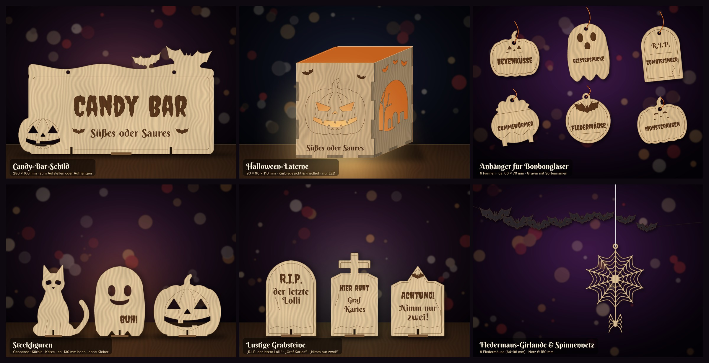
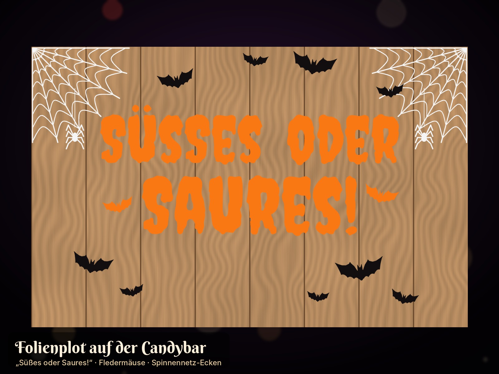

# Weihnachtsdeko für den xTool D1 Pro 10W

Fünf Entwürfe als laserfertige SVG-Dateien (Maßstab 1:1 in mm) mit Mockup und Laservorschau.


| # | Entwurf | Teile | Fläche (mm) | Datei |
|---|---------|-------|-------------|-------|
| 1 | Schneeflocken-Anhänger (3 Varianten, eine mit „2026“) | 3 | 216 × 90 | `entwuerfe/01_schneeflocken/01_schneeflocken.svg` |
| 2 | 3D-Steck-Tannenbaum, 180 mm hoch, plus Passungstest | 3 | 256 × 215 | `entwuerfe/02_steck-tannenbaum/02_steck-tannenbaum.svg` |
| 3 | Weihnachtssterne: Gruß-Stern + Filigran-Stern, 100 mm | 2 | 193 × 94 | `entwuerfe/03_sterne/03_sterne.svg` |
| 4 | Teelicht-Laterne „Winterdorf“, 90 × 90 × 110 mm, Fingerzinken | 5 | 292 × 236 | `entwuerfe/04_teelicht-laterne/04_teelicht-laterne.svg` |
| 5 | Geschenkanhänger-Set (Kugel, Baum, klassisch) | 6 | 248 × 163 | `entwuerfe/05_geschenkanhaenger/05_geschenkanhaenger.svg` |

Alle Entwürfe passen auf die Arbeitsfläche des D1 Pro (432 × 406 mm). Ausgelegt sind sie für **3 mm Pappel- oder Lindensperrholz**.

## Farben = Bearbeitungsart (in xTool Creative Space)

| Farbe | Ebene | Bearbeitung in XCS |
|-------|-------|--------------------|
| 🔴 Rot `#FF0000` | Schneiden | **Schneiden** (Kontur) |
| 🔵 Blau `#0000FF` | Gravieren | **Gravieren** (Flächenfüllung) |
| ⚫ Schwarz `#000000` | Linie | **Gravieren**, Modus *Linie/Ritzen* (Score) |

Die Dateien enthalten keine Schrift-Objekte: Alle Texte sind bereits in Pfade umgewandelt.

## Startwerte für den D1 Pro 10W

| Vorgang | Leistung | Geschwindigkeit | Durchgänge | Hinweis |
|---------|----------|-----------------|------------|---------|
| Schneiden 3 mm Linde | 100 % | 8–12 mm/s | 1 | Air Assist an |
| Schneiden 3 mm Pappelsperrholz | 100 % | 6–10 mm/s | 1–2 | Leimschicht kann einen 2. Durchgang brauchen |
| Gravieren (Fläche) | 25–40 % | 150–250 mm/s | 1 | ca. 100 Linien/cm |
| Linie (Score) | 20–30 % | 50–80 mm/s | 1 | |

Holz fällt sehr unterschiedlich aus. Mach deshalb vorher ein **Materialtest-Raster** in XCS und stell den Fokus genau ein.

**Reihenfolge:** zuerst gravieren, dann Linien, **zuletzt schneiden**. In der SVG ist das so vorsortiert, und innere Ausschnitte werden vor der Außenkontur geschnitten. Ein Abdeckband (Malerkrepp) auf dem Holz verhindert Rauchspuren.

## Tipps zu den einzelnen Entwürfen

1. **Schneeflocken:** Die Stege sind 3 mm breit. Für Bänder und Garn hat jede Flocke eine Öse mit Ø 4 mm.
2. **Steck-Tannenbaum:** Teil A wird von unten, Teil B von oben zusammengesteckt. Der Schlitz ist auf **2,9 mm** ausgelegt. Schneide zuerst den **Passungstest-Streifen** mit Schlitzen von 2,7 bis 3,2 mm und prüf, welcher Schlitz stramm sitzt. Weicht dein Wert ab, ändere `SLOT` in `tools/designs.py` und erzeuge die Dateien neu.
3. **Sterne:** Den Text („Frohe Weihnachten 2026“) kannst du in XCS löschen und durch einen Namen ersetzen.
4. **Laterne:** Die Teile sind Vorderwand (mit Gravur), Rückwand, zwei Seitenwände und der Boden mit Ø-22-mm-Loch für den Schalter des LED-Teelichts. Die Zinken stecken sich zusammen, ein Tropfen Holzleim macht die Laterne stabil. Wenn du Transparentpapier von innen einklebst, wird das Licht weicher. ⚠️ **Nur LED-Teelichter verwenden, keine echten Kerzen!**
5. **Geschenkanhänger:** Auf „Für:“ und „Von:“ kannst du mit Bleistift oder Fineliner schreiben. Für Kordel oder Garn gibt es Löcher mit Ø 4–5 mm.

## Dateien neu erzeugen und anpassen

```bash
pip install shapely fonttools cairosvg pillow numpy
python3 tools/build.py
```

- `tools/designs.py`: Formen, Texte, Materialstärke (`MAT`) und Schlitzbreite (`SLOT`)
- `tools/lasergeo.py`: Geometrie, Text-zu-Pfad und SVG-Export
- `tools/render.py` und `tools/build.py`: Mockups und Vorschauen

Die Schriften *Great Vibes* und *Berkshire Swash* stehen unter der SIL Open Font License (siehe `tools/fonts/`).

---

# Gelayerte Weltkarte (5 Schichten)


Eine 3D-Weltkarte mit rechteckigem Rahmen, **400 × 183 mm**, aus 5 Lagen **3 mm Sperrholz** (zusammen 15 mm dick). Die Meeresschichten haben organische Tiefenlinien. Jede Schicht ist eine eigene SVG und passt allein auf die Arbeitsfläche.

| Schicht | Inhalt | Datei | Farbidee |
|---------|--------|-------|----------|
| 1 | Grundplatte (tiefstes Meer) | `06_weltkarte_schicht1.svg` | dunkles Violett |
| 2 | Meer tief + Rahmen | `06_weltkarte_schicht2.svg` | Violett |
| 3 | Meer mittel + Rahmen | `06_weltkarte_schicht3.svg` | Flieder |
| 4 | Meer flach + Rahmen | `06_weltkarte_schicht4.svg` | helles Lavendel |
| 5 | Rahmen + 75 Land-Teile mit Ländergrenzen (Linie) und Seen (Gravur) | `06_weltkarte_schicht5.svg` | Holz natur |
| – | 2 Aufsteller (Schlitz 15,3 mm, 8° geneigt) | `06_weltkarte_aufsteller.svg` | – |

Alle Dateien liegen in `entwuerfe/06_weltkarte-layered/`. Die Übersicht aller Schichten steht in `06_weltkarte_schichten.png`.

**Zusammenbau:** Bemal die Schichten 1 bis 4 vor dem Verleimen, am besten mit Beize oder verdünnter Acrylfarbe, damit die Maserung durchscheint. Danach verleimst du die Schichten von unten nach oben, Rahmen auf Rahmen. Lose Teile (z. B. Hawaii in Schicht 3 und 4) und die Kontinente aus Schicht 5 klebst du mittig auf die jeweils größere Form darunter, die rundherum etwa 3–4 mm übersteht. Zum Aufhängen eignet sich ein Zackenaufhänger auf der Rückseite, alternativ stellst du die Karte in die zwei Aufsteller.

**Anpassen** (`tools/weltkarte.py`): Größe `W_OUT`, Rahmenbreite `FRAME`, Abstand der Tiefenlinien `LEVELS`, Wellung `NOISE`/`SEED`, Materialstärke `MAT` (für den Aufsteller-Schlitz). Neu erzeugen:

```bash
pip install shapely pyproj scipy scikit-image cairosvg pillow numpy fonttools
python3 tools/weltkarte.py
```

Kartendaten: [Natural Earth](https://www.naturalearthdata.com/) 1:50m (Public Domain), Robinson-Projektion, ohne Antarktis.

---

# Halloween-Deko für die Candybar



Alles liegt in `entwuerfe/halloween/`: sechs Holzentwürfe für den **xTool D1 Pro** (`laser/`) und sechs Schneidedateien für den **Schneideplotter** (`plotter/`). Für die Laserdateien gilt dieselbe Farblogik wie oben (Rot = Schneiden, Blau = Gravieren, Schwarz = Linie). Ausgelegt sind sie für **3 mm Pappel- oder Lindensperrholz**.

## Laser (xTool D1 Pro)

| # | Entwurf | Teile | Fläche (mm) | Datei |
|---|---------|-------|-------------|-------|
| 1 | Candy-Bar-Schild „Candy Bar – Süßes oder Saures“ mit Kürbis und Fledermäusen, 2 Standfüße | 3 | 305 × 202 | `laser/01_candybar-schild/01_candybar-schild.svg` |
| 2 | Laterne 90 × 90 × 110 mm: Kürbisgesicht vorne, Friedhof auf den Seiten, Mond und Fledermäuse hinten | 5 | 292 × 236 | `laser/02_kuerbis-laterne/02_kuerbis-laterne.svg` |
| 3 | Anhänger für Bonbongläser: Hexenküsse, Geisterspucke, Zombiefinger, Gummiwürmer, Fledermäuse, Monsteraugen | 6 | 258 × 155 | `laser/03_glas-anhaenger/03_glas-anhaenger.svg` |
| 4 | Steckfiguren Gespenst, Kürbis und Katze (ca. 130 mm), jede mit Standfuß | 6 | 263 × 296 | `laser/04_steckfiguren/04_steckfiguren.svg` |
| 5 | Lustige Grabsteine „R.I.P. der letzte Lolli“, „Hier ruht Graf Karies“, „Achtung! Nimm nur zwei!“ | 6 | 260 × 170 | `laser/05_grabsteine/05_grabsteine.svg` |
| 6 | Fledermaus-Girlande (8 Fledermäuse, 64–96 mm) und Spinnennetz Ø 150 mm mit Spinne | 9 | 290 × 305 | `laser/06_fledermaus-girlande/06_fledermaus-girlande.svg` |

Jeder Ordner enthält zusätzlich ein Mockup (`*_mockup.jpg`) und eine Laservorschau (`*_laservorschau.png`). Die Startwerte und die Reihenfolge (gravieren → Linie → schneiden) aus der Tabelle oben gelten auch hier.

**Tipps**
- **Standfüße (Schild, Figuren, Grabsteine):** Die Figur hat unten einen Schlitz, der Fuß oben einen. Beide werden über Kreuz gesteckt. Schlitzbreite ist **2,9 mm** wie beim Tannenbaum. Mach vorher den Passungstest aus Entwurf 2 der Weihnachtsdeko und pass `SLOT` in `tools/designs.py` an, falls nötig. Das Schild hat außerdem zwei Löcher (Ø 5 mm), damit du es auch aufhängen kannst.
- **Bemalen:** Kürbis orange, Katze und Fledermäuse schwarz, Gespenst weiß, Grabsteine grau (Kreide- oder Acrylfarbe). Gravur und Linien bleiben sichtbar, wenn du dünn lasierst oder erst nach dem Malen gravierst.
- **Laterne:** Gleicher Aufbau wie die Weihnachtslaterne (Fingerzinken, Boden mit Loch für den Schalter). Orangefarbenes Transparentpapier innen sieht toll aus. ⚠️ **Nur LED-Teelichter!**
- **Girlande:** Fädle eine Schnur durch die beiden Flügellöcher. Das Spinnennetz ist sehr filigran (Stege 2,6 mm), deshalb mit Air Assist und eher langsam schneiden.
- **Glas-Anhänger:** Die Namen kannst du in XCS ändern. Für die Kordel gibt es oben ein Loch mit Ø 4,4–4,8 mm, damit sich der Anhänger um den Glashals binden lässt.

## Schneideplotter (Folie, Karton)



| # | Motiv | Größe (mm) | Idee |
|---|-------|------------|------|
| 1 | „Süßes oder Saures!“ mit 2 Fledermäusen | 300 × 137 | Orange Folie auf die Holzfront der Candybar |
| 2 | „Candy Bar“ mit 3 Fledermäusen | 300 × 130 | Über der Bar oder auf dem Schild |
| 3 | Fledermausschwarm, 20 Stück (25–110 mm) | 288 × 276 | Wand, Spiegel, Holz; aus schwarzem Tonkarton und mit hochgeknickten Flügeln wirkt er 3D |
| 4 | Spinnennetz-Ecke mit Spinne | 271 × 282 | Weiße Folie in die Ecken; für die zweite Ecke spiegeln |
| 5 | 6 Gesichter (3 Kürbis, 3 Gespenst), je 90 mm | 268 × 97 | Schwarz auf orange oder weiße Gläser, Becher, Tüten |
| 6 | 6 Sortennamen (passend zu den Laser-Anhängern) | 270 × 101 | Direkt auf die Bonbongläser |

Jedes Motiv gibt es als **SVG** (Cricut Design Space, Silhouette Studio ab Designer Edition, Brother CanvasWorkspace, Inkscape) und als **DXF R12** (läuft auch in Silhouette Studio Basic), dazu eine PNG-Vorschau. Die Dateien sind im Maßstab 1:1 in mm angelegt und passen auf eine 12″-Schneidematte (305 mm). Prüf nach dem Import die Größe: Manche Programme rechnen in Zoll oder Pixel um.

- **Klebefolie (Vinyl)** wird nicht gespiegelt. **Flex- oder Bügelfolie** (z. B. für Stoffbeutel) musst du vor dem Schneiden **spiegeln**.
- Auf Glas hält normale Plotterfolie gut und lässt sich nach Halloween rückstandsfrei abziehen. Für Holz eignet sich matte Folie, die sieht hochwertiger aus.
- Fürs Entgittern kannst du in der Plottersoftware einen Rahmen um jedes Motiv ziehen.

## Neu erzeugen und anpassen

```bash
pip install shapely fonttools cairosvg pillow numpy
python3 tools/build_halloween.py
```

- `tools/halloween.py`: alle Formen (Fledermaus, Kürbis, Gespenst, Katze, Grabstein, Spinnennetz), Texte und Plotter-Motive
- `tools/build_halloween.py`: Export (Laser-SVG, Plotter-SVG und DXF), Vorschauen und Mockups

Die Schrift *Creepster* steht unter der SIL Open Font License (siehe `tools/fonts/OFL-Creepster.txt`).
