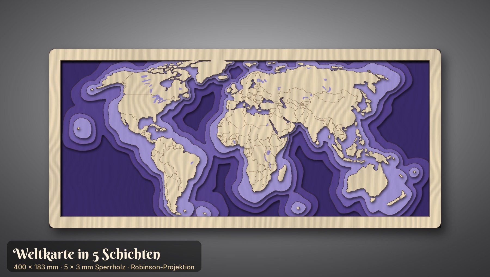

# Weihnachtsdeko für den xTool D1 Pro 10W

Fünf Entwürfe als laserfertige SVG-Dateien (Maßstab 1:1 in mm) mit Mockup und Laservorschau.


| # | Entwurf | Teile | Fläche (mm) | Datei |
|---|---------|-------|-------------|-------|
| 1 | Schneeflocken-Anhänger (3 Varianten, eine mit „2026“) | 3 | 216 × 90 | `entwuerfe/01_schneeflocken/01_schneeflocken.svg` |
| 2 | 3D-Steck-Tannenbaum, 180 mm hoch, plus Passungstest | 3 | 256 × 215 | `entwuerfe/02_steck-tannenbaum/02_steck-tannenbaum.svg` |
| 3 | Weihnachtssterne: Gruß-Stern + Filigran-Stern, 100 mm | 2 | 193 × 94 | `entwuerfe/03_sterne/03_sterne.svg` |
| 4 | Teelicht-Laterne „Winterdorf“, 90 × 90 × 110 mm, Fingerzinken | 5 | 292 × 236 | `entwuerfe/04_teelicht-laterne/04_teelicht-laterne.svg` |
| 5 | Geschenkanhänger-Set (Kugel, Baum, klassisch) | 6 | 248 × 163 | `entwuerfe/05_geschenkanhaenger/05_geschenkanhaenger.svg` |

Alle Entwürfe passen auf die Arbeitsfläche des D1 Pro (432 × 406 mm). Ausgelegt sind sie für **3 mm Pappel- oder Lindensperrholz**.

## Farben = Bearbeitungsart (in xTool Creative Space)

| Farbe | Ebene | Bearbeitung in XCS |
|-------|-------|--------------------|
| 🔴 Rot `#FF0000` | Schneiden | **Schneiden** (Kontur) |
| 🔵 Blau `#0000FF` | Gravieren | **Gravieren** (Flächenfüllung) |
| ⚫ Schwarz `#000000` | Linie | **Gravieren**, Modus *Linie/Ritzen* (Score) |

Die Dateien enthalten keine Schrift-Objekte: Alle Texte sind bereits in Pfade umgewandelt.

## Startwerte für den D1 Pro 10W

| Vorgang | Leistung | Geschwindigkeit | Durchgänge | Hinweis |
|---------|----------|-----------------|------------|---------|
| Schneiden 3 mm Linde | 100 % | 8–12 mm/s | 1 | Air Assist an |
| Schneiden 3 mm Pappelsperrholz | 100 % | 6–10 mm/s | 1–2 | Leimschicht kann einen 2. Durchgang brauchen |
| Gravieren (Fläche) | 25–40 % | 150–250 mm/s | 1 | ca. 100 Linien/cm |
| Linie (Score) | 20–30 % | 50–80 mm/s | 1 | |

Holz fällt sehr unterschiedlich aus. Mach deshalb vorher ein **Materialtest-Raster** in XCS und stell den Fokus genau ein.

**Reihenfolge:** zuerst gravieren, dann Linien, **zuletzt schneiden**. In der SVG ist das so vorsortiert, und innere Ausschnitte werden vor der Außenkontur geschnitten. Ein Abdeckband (Malerkrepp) auf dem Holz verhindert Rauchspuren.

## Tipps zu den einzelnen Entwürfen

1. **Schneeflocken:** Die Stege sind 3 mm breit. Für Bänder und Garn hat jede Flocke eine Öse mit Ø 4 mm.
2. **Steck-Tannenbaum:** Teil A wird von unten, Teil B von oben zusammengesteckt. Der Schlitz ist auf **2,9 mm** ausgelegt. Schneide zuerst den **Passungstest-Streifen** mit Schlitzen von 2,7 bis 3,2 mm und prüf, welcher Schlitz stramm sitzt. Weicht dein Wert ab, ändere `SLOT` in `tools/designs.py` und erzeuge die Dateien neu.
3. **Sterne:** Den Text („Frohe Weihnachten 2026“) kannst du in XCS löschen und durch einen Namen ersetzen.
4. **Laterne:** Die Teile sind Vorderwand (mit Gravur), Rückwand, zwei Seitenwände und der Boden mit Ø-22-mm-Loch für den Schalter des LED-Teelichts. Die Zinken stecken sich zusammen, ein Tropfen Holzleim macht die Laterne stabil. Wenn du Transparentpapier von innen einklebst, wird das Licht weicher. ⚠️ **Nur LED-Teelichter verwenden, keine echten Kerzen!**
5. **Geschenkanhänger:** Auf „Für:“ und „Von:“ kannst du mit Bleistift oder Fineliner schreiben. Für Kordel oder Garn gibt es Löcher mit Ø 4–5 mm.

## Dateien neu erzeugen und anpassen

```bash
pip install shapely fonttools cairosvg pillow numpy
python3 tools/build.py
```

- `tools/designs.py`: Formen, Texte, Materialstärke (`MAT`) und Schlitzbreite (`SLOT`)
- `tools/lasergeo.py`: Geometrie, Text-zu-Pfad und SVG-Export
- `tools/render.py` und `tools/build.py`: Mockups und Vorschauen

Die Schriften *Great Vibes* und *Berkshire Swash* stehen unter der SIL Open Font License (siehe `tools/fonts/`).

---

# Gelayerte Weltkarte (5 Schichten)



Eine 3D-Weltkarte mit rechteckigem Rahmen, **400 × 183 mm**, aus 5 Lagen **3 mm Sperrholz** (zusammen 15 mm dick). Die Meeresschichten haben organische Tiefenlinien. Jede Schicht ist eine eigene SVG und passt allein auf die Arbeitsfläche.

| Schicht | Inhalt | Datei | Farbidee |
|---------|--------|-------|----------|
| 1 | Grundplatte (tiefstes Meer) | `06_weltkarte_schicht1.svg` | dunkles Violett |
| 2 | Meer tief + Rahmen | `06_weltkarte_schicht2.svg` | Violett |
| 3 | Meer mittel + Rahmen | `06_weltkarte_schicht3.svg` | Flieder |
| 4 | Meer flach + Rahmen | `06_weltkarte_schicht4.svg` | helles Lavendel |
| 5 | Rahmen + 75 Land-Teile mit Ländergrenzen (Linie) und Seen (Gravur) | `06_weltkarte_schicht5.svg` | Holz natur |
| – | 2 Aufsteller (Schlitz 15,3 mm, 8° geneigt) | `06_weltkarte_aufsteller.svg` | – |

Alle Dateien liegen in `entwuerfe/06_weltkarte-layered/`. Die Übersicht aller Schichten steht in `06_weltkarte_schichten.png`.

**Zusammenbau:** Bemal die Schichten 1 bis 4 vor dem Verleimen, am besten mit Beize oder verdünnter Acrylfarbe, damit die Maserung durchscheint. Danach verleimst du die Schichten von unten nach oben, Rahmen auf Rahmen. Lose Teile (z. B. Hawaii in Schicht 3 und 4) und die Kontinente aus Schicht 5 klebst du mittig auf die jeweils größere Form darunter, die rundherum etwa 3–4 mm übersteht. Zum Aufhängen eignet sich ein Zackenaufhänger auf der Rückseite, alternativ stellst du die Karte in die zwei Aufsteller.

**Anpassen** (`tools/weltkarte.py`): Größe `W_OUT`, Rahmenbreite `FRAME`, Abstand der Tiefenlinien `LEVELS`, Wellung `NOISE`/`SEED`, Materialstärke `MAT` (für den Aufsteller-Schlitz). Neu erzeugen:

```bash
pip install shapely pyproj scipy scikit-image cairosvg pillow numpy fonttools
python3 tools/weltkarte.py
```

Kartendaten: [Natural Earth](https://www.naturalearthdata.com/) 1:50m (Public Domain), Robinson-Projektion, ohne Antarktis.
