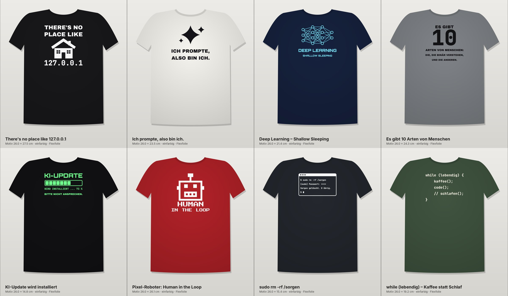

# T-Shirt-Motive für IT- und KI-Fans: Silhouette Cameo, einfarbig

Acht Motive zum Plotten und Aufbügeln mit Flex- oder Flockfolie. Jedes Motiv ist **26 cm breit** und damit eine typische Brustgröße für Shirts in M bis XL. Alle Texte sind bereits in Pfade umgewandelt, du brauchst also keine Schriften zu installieren.



| # | Motiv | Größe (B × H) | Idee |
|---|-------|---------------|------|
| 1 | `01_localhost` | 26,0 × 27,5 cm | „There's no place like 127.0.0.1“ mit Haus |
| 2 | `02_ich-prompte` | 26,0 × 23,5 cm | „Ich prompte, also bin ich.“ mit KI-Funkeln |
| 3 | `03_deep-learning` | 26,0 × 21,4 cm | Neuronales Netz: „Deep Learning – Shallow Sleeping“ |
| 4 | `04_10-arten` | 26,0 × 24,3 cm | „Es gibt 10 Arten von Menschen …“ |
| 5 | `05_ki-update` | 26,0 × 14,8 cm | KI-Update mit Ladebalken: „Bitte nicht ansprechen.“ |
| 6 | `06_human-in-the-loop` | 26,0 × 26,1 cm | Pixel-Roboter: „Human in the Loop“ |
| 7 | `07_sudo-sorgen` | 26,0 × 15,4 cm | Terminalfenster: `sudo rm -rf /sorgen` |
| 8 | `08_while-lebendig` | 26,0 × 19,2 cm | `while (lebendig) { kaffee(); code(); // schlafen(); }` |

## Dateien pro Motiv

| Datei | Wofür |
|-------|-------|
| `*.svg` | Silhouette Studio **Designer Edition** oder höher, außerdem Cricut und Inkscape. Maßstab 1:1 in mm. |
| `*.dxf` | Silhouette Studio **Basic Edition** (die kostenlose Version öffnet keine SVG-Dateien). |
| `*_300dpi.png` | Schwarz auf transparentem Hintergrund. Zum Nachzeichnen („Trace“) oder für die Vorschau. |
| `*_mockup.jpg` | So sieht das Motiv auf dem Shirt aus. |

Um jedes Motiv liegt ein **Entgitterrahmen** mit 6 mm Abstand. Mit ihm lässt sich das Restmaterial in einem Stück abziehen. Wenn du ihn nicht willst, lösch ihn in Studio einfach.

## Ablauf mit dem Cameo

1. **Importieren:** SVG bzw. DXF öffnen. Danach die Größe prüfen: Die Breite muss **26 cm** plus Rahmen betragen (siehe Tabelle). Falls Studio beim DXF eine andere Größe zeigt, das Motiv proportional auf diese Breite skalieren.
2. **⚠️ Spiegeln!** Rechtsklick → *Horizontal spiegeln*. Die Dateien sind lesbar ausgerichtet, damit Vorschau und Mockup stimmen.
3. **Folie einlegen:** Glänzende Trägerseite nach **unten** auf die Matte, matte Klebeseite nach oben.
4. **Schneiden:** In Studio das Material „Heat Transfer, Smooth“ oder „Flock“ wählen. Startwerte für Flexfolie: Klinge 2–3, Kraft 6–8, Geschwindigkeit 5–8, 1 Durchgang. **Probeschnitt** machen: Die Folie soll durch sein, der Träger nur angeritzt.
5. **Entgittern:** Alles abziehen, was nicht aufs Shirt soll. Die kleinen Innenflächen in Buchstaben (a, e, o, 0 usw.) mit dem Entgitterhaken herauspicken.
6. **Aufbügeln:** Shirt kurz vorbügeln, damit es glatt und trocken ist. Das Motiv mit der Trägerfolie nach oben auflegen, Backpapier darüber. Bei Bügeleisen auf Baumwollstufe ohne Dampf ca. 15–20 s pro Stelle **fest drücken, nicht schieben**. Bei einer Transferpresse ca. 150–160 °C, 12–15 s. Danach die Trägerfolie je nach Folie warm oder kalt abziehen (siehe Herstellerangabe).
7. **Pflege:** 24 h nicht waschen. Danach auf links drehen, bei 40 °C waschen und nicht in den Trockner.

**Position auf dem Shirt:** Die Oberkante des Motivs sitzt etwa 7–9 cm unter der Halsnaht, also ungefähr eine Handbreite. Zum Zentrieren das Shirt längs falten und die Mitte mit dem Bügeleisen leicht markieren.

## Hinweise zum Schneiden

- Die schmalsten Stege sind ca. **1,5 mm** breit (Monospace-Schrift in Motiv 7 und 8). Das ist für Flexfolie unkritisch. Flockfolie ist dicker. Falls Teile ausreißen, das Motiv größer skalieren oder die Geschwindigkeit senken.
- **Motiv 3 (Netz)** hat viele kleine Dreiecke zwischen den Verbindungslinien. Es dauert beim Entgittern am längsten.
- Für Kinder- oder Damenshirts auf 20–22 cm Breite verkleinern. Darunter werden die kleinen Zeilen in Motiv 4, 5 und 7 fummelig.
- Für die Cameo-4/5-Matte mit 30,5 cm Breite passt jedes Motiv inklusive Rahmen quer.

## Anpassen und neu erzeugen

Alle Motive entstehen per Skript aus `tools/tshirt.py`. Dort kannst du Texte ändern (z. B. „lebendig“ → „wach“) und die Dateien neu erzeugen:

```bash
pip install shapely fonttools cairosvg pillow numpy
python3 tools/tshirt.py
```

Schriften: *Archivo Black*, *JetBrains Mono*, *Orbitron* und *Press Start 2P* stehen alle unter der SIL Open Font License (siehe `tools/fonts/`). Sie dürfen auch für verkaufte Shirts verwendet werden. Die Sprüche selbst sind verbreitete Nerd-Klassiker bzw. eigene Formulierungen. Für einen gewerblichen Verkauf solltest du trotzdem kurz prüfen, ob jemand einen Spruch als Marke angemeldet hat.
