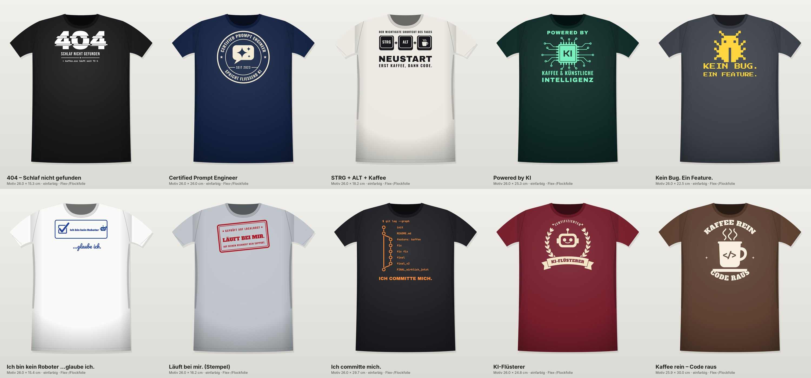
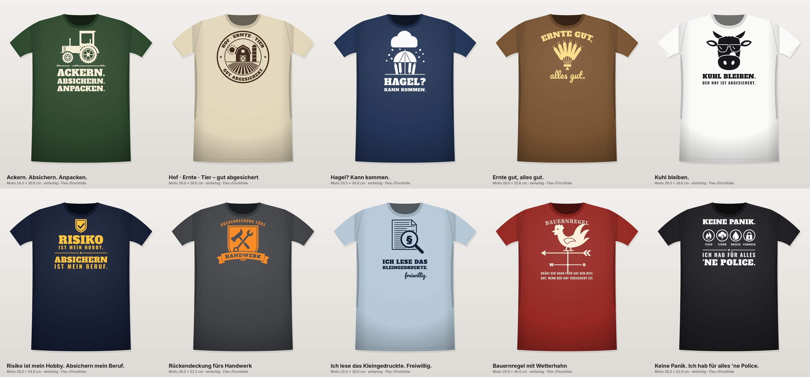

# T-Shirt-Motive für den Silhouette Cameo: einfarbig zum Aufbügeln

Alle Motive sind Plotterdateien für Flex- oder Flockfolie. Sie sind meist **26 cm breit** (oder max. 30 cm hoch) und damit eine typische Brustgröße für Shirts in M bis XL. Texte sind bereits in Pfade umgewandelt.

| Ordner | Inhalt |
|--------|--------|
| [`serie2_it-ki/`](serie2_it-ki) | **10 IT- & KI-Motive**, überarbeitet: Abzeichen, Illustrationen, Bogentext |
| [`serie3_versicherung/`](serie3_versicherung) | **10 Motive Versicherung · Gewerbe & Landwirtschaft** |
| [`serie1_it-ki/`](serie1_it-ki) | 8 erste, einfachere IT-/KI-Entwürfe |

## Serie 2: IT & KI



| # | Motiv | Größe (B × H) |
|---|-------|---------------|
| 1 | `01_404-schlaf`: Glitch-„404“, „Schlaf nicht gefunden“ | 26,0 × 15,3 cm |
| 2 | `02_prompt-engineer`: Rundes Abzeichen „Certified Prompt Engineer · spricht fließend KI“ | 26,0 × 26,0 cm |
| 3 | `03_strg-alt-kaffee`: Tastenkappen STRG + ALT + Kaffeetasse, „Neustart“ | 26,0 × 18,2 cm |
| 4 | `04_powered-by-ki`: Chip mit Leiterbahnen, „Powered by Kaffee & künstliche Intelligenz“ | 26,0 × 25,3 cm |
| 5 | `05_kein-bug`: Pixel-Käfer, „Kein Bug. Ein Feature.“ | 26,0 × 22,5 cm |
| 6 | `06_kein-roboter`: Captcha-Kästchen „Ich bin kein Roboter“ … *glaube ich.* | 26,0 × 15,4 cm |
| 7 | `07_laeuft-bei-mir`: Stempel „Läuft bei mir. Geprüft auf localhost“ | 26,0 × 16,2 cm |
| 8 | `08_ich-committe-mich`: Git-Graph von „init“ bis „FINAL_wirklich_jetzt“ | 26,0 × 29,7 cm |
| 9 | `09_ki-fluesterer`: Roboter im Lorbeerkranz mit Schriftband „KI-Flüsterer“ | 26,0 × 24,8 cm |
| 10 | `10_kaffee-rein-code-raus`: Tasse mit `</>` und Bogentext | 25,9 × 30,0 cm |

## Serie 3: Versicherung · Gewerbe & Landwirtschaft



| # | Motiv | Größe (B × H) |
|---|-------|---------------|
| 1 | `01_ackern-absichern-anpacken`: Traktor, „Ackern. Absichern. Anpacken.“ | 24,3 × 30,0 cm |
| 2 | `02_hof-badge`: Abzeichen mit Scheune, Silo, Sonne und Feld, „Hof · Ernte · Tier – gut abgesichert“ | 26,0 × 26,0 cm |
| 3 | `03_hagel-kann-kommen`: Hagelwolke, Schirm über Ähren | 20,5 × 30,0 cm |
| 4 | `04_ernte-gut-alles-gut`: Ährengarbe, „Ernte gut, *alles gut.*“ | 26,0 × 25,8 cm |
| 5 | `05_kuhl-bleiben`: Kuh mit Sonnenbrille, „Kuhl bleiben. Der Hof ist abgesichert.“ | 26,0 × 26,6 cm |
| 6 | `06_risiko-hobby`: „Risiko ist mein Hobby. Absichern ist mein Beruf.“ | 26,0 × 24,6 cm |
| 7 | `07_rueckendeckung-handwerk`: Wappen mit Hammer & Schlüssel, „Rückendeckung fürs Handwerk“ | 26,0 × 22,2 cm |
| 8 | `08_kleingedrucktes`: Lupe mit §, „Ich lese das Kleingedruckte. *freiwillig.*“ | 22,0 × 30,0 cm |
| 9 | `09_bauernregel-wetterhahn`: Wetterhahn, „Kräht der Hahn früh auf dem Mist, gut, wenn der Hof versichert ist.“ | 25,8 × 30,0 cm |
| 10 | `10_fuer-alles-ne-police`: Icons Feuer/Sturm/Wasser/Einbruch, „Keine Panik. Ich hab für alles 'ne Police.“ | 26,0 × 22,9 cm |

Die Versicherungsmotive sind **markenneutral**: kein Firmenname, kein Logo und keine konkreten Leistungsversprechen. Wenn du sie bei der Arbeit oder auf Messen trägst, kläre kurz mit deinem Arbeitgeber, ob eigene Shirts mit Branchenbezug in Ordnung sind.

## Dateien pro Motiv

| Datei | Wofür |
|-------|-------|
| `*.svg` | Silhouette Studio **Designer Edition** oder höher, außerdem Cricut und Inkscape. Maßstab 1:1 in mm. |
| `*.dxf` | Silhouette Studio **Basic Edition** (die kostenlose Version öffnet keine SVG-Dateien). |
| `*_300dpi.png` | Schwarz auf transparentem Hintergrund. Zum Nachzeichnen („Trace“) oder für die Vorschau. |
| `*_mockup.jpg` | So sieht das Motiv auf dem Shirt aus. |

Um jedes Motiv liegt ein **Entgitterrahmen** mit 6 mm Abstand. Mit ihm lässt sich das Restmaterial in einem Stück abziehen. Wenn du ihn nicht willst, lösch ihn in Studio einfach.

## Ablauf mit dem Cameo

1. **Importieren:** SVG bzw. DXF öffnen. Danach die Größe prüfen: Breite und Höhe müssen der Tabelle entsprechen (plus 1,2 cm Rahmen). Falls Studio beim DXF eine andere Größe zeigt, das Motiv proportional auf diese Größe skalieren.
2. **⚠️ Spiegeln!** Rechtsklick → *Horizontal spiegeln*. Die Dateien sind lesbar ausgerichtet, damit Vorschau und Mockup stimmen.
3. **Folie einlegen:** Glänzende Trägerseite nach **unten** auf die Matte, matte Klebeseite nach oben.
4. **Schneiden:** In Studio das Material „Heat Transfer, Smooth“ oder „Flock“ wählen. Startwerte für Flexfolie: Klinge 2–3, Kraft 6–8, Geschwindigkeit 5–8, 1 Durchgang. **Probeschnitt** machen: Die Folie soll durch sein, der Träger nur angeritzt.
5. **Entgittern:** Alles abziehen, was nicht aufs Shirt soll. Die kleinen Innenflächen in Buchstaben (a, e, o, 0 usw.) mit dem Entgitterhaken herauspicken.
6. **Aufbügeln:** Shirt kurz vorbügeln, damit es glatt und trocken ist. Das Motiv mit der Trägerfolie nach oben auflegen, Backpapier darüber. Bei Bügeleisen auf Baumwollstufe ohne Dampf ca. 15–20 s pro Stelle **fest drücken, nicht schieben**. Bei einer Transferpresse ca. 150–160 °C, 12–15 s. Danach die Trägerfolie je nach Folie warm oder kalt abziehen (siehe Herstellerangabe).
7. **Pflege:** 24 h nicht waschen. Danach auf links drehen, bei 40 °C waschen und nicht in den Trockner.

**Position auf dem Shirt:** Die Oberkante des Motivs sitzt etwa 7–9 cm unter der Halsnaht, also ungefähr eine Handbreite. Zum Zentrieren das Shirt längs falten und die Mitte mit dem Bügeleisen leicht markieren.

## Hinweise zum Schneiden

- Die schmalsten Stege sind ca. **1,3–1,5 mm** breit. Das ist für Flexfolie unkritisch. Flockfolie ist dicker. Falls Teile ausreißen, das Motiv größer skalieren oder die Geschwindigkeit senken.
- Am aufwendigsten zu entgittern: Serie 2 Nr. 8 (Git-Graph, kleine Monospace-Schrift), Serie 3 Nr. 9 (Bauernregel-Text) und Serie 1 Nr. 3 (Netz).
- Freistehende Kleinteile (Hagelkörner, Punkte, i-Punkte) beim Entgittern auf der Trägerfolie lassen und mit aufbügeln.
- Für Kinder- oder Damenshirts auf 20–22 cm Breite verkleinern. Darunter werden kleine Zeilen fummelig.
- Für die Cameo-4/5-Matte mit 30,5 cm Breite passt jedes Motiv inklusive Rahmen quer.

## Anpassen und neu erzeugen

Alle Motive entstehen per Skript. Dort kannst du Texte ändern (z. B. „Hof“ → „Betrieb“) und die Dateien neu erzeugen:

```bash
pip install shapely fonttools cairosvg pillow numpy uharfbuzz svgelements skia-pathops
python3 tools/serie2_it_ki.py          # Serie 2
python3 tools/serie3_versicherung.py   # Serie 3
python3 tools/tshirt.py                # Serie 1
python3 tools/serie3_versicherung.py 05   # nur ein Motiv (Präfix)
```

`tools/vinyl.py` ist der Werkzeugkasten: Schrift mit Kerning, Bogentext, Schriftbänder, Lorbeer, Export und Mockup.

Schriften: *Alfa Slab One*, *Archivo Black*, *Bebas Neue*, *Bungee*, *JetBrains Mono*, *Kanit*, *Orbitron*, *Oswald*, *Pacifico*, *Press Start 2P* und *Rye* stehen alle unter der SIL Open Font License (siehe `tools/fonts/`). Sie dürfen auch für verkaufte Shirts verwendet werden. Die Sprüche selbst sind verbreitete Nerd-Klassiker bzw. eigene Formulierungen. Für einen gewerblichen Verkauf solltest du trotzdem kurz prüfen, ob jemand einen Spruch als Marke angemeldet hat.
